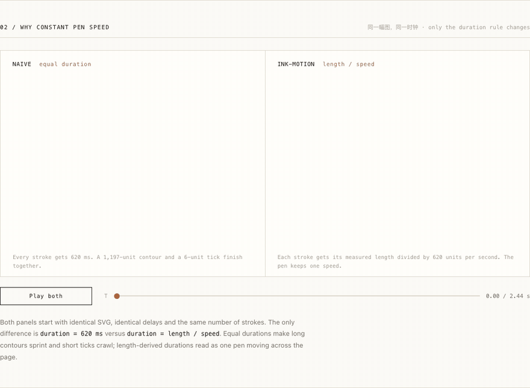
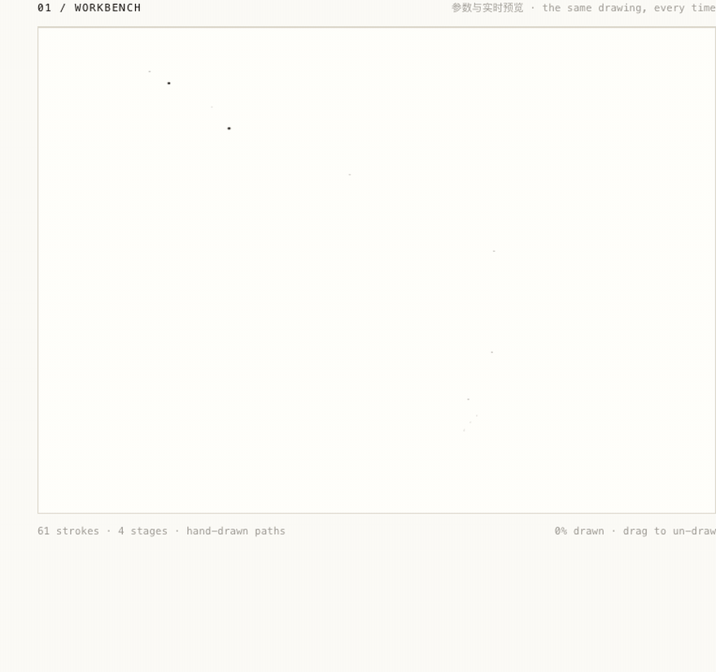
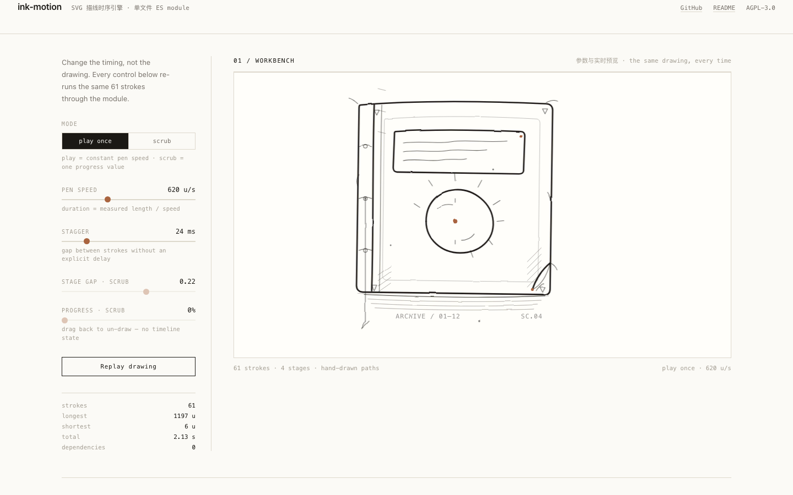

# ink-motion

A timing engine for hand-drawn SVG. It does not draw anything — it decides **when each stroke finishes**.



`src/ink-motion.js` · 6.9 kB · one ES module · zero dependencies · no build step · AGPL-3.0

## The problem

Give every path the same duration and a 1,197-unit contour finishes at the same moment as a 6-unit tick. Long lines sprint, short ticks crawl, and the result reads as a reveal effect rather than a pen moving across paper.

The animation above uses identical SVG on both sides, identical stroke order and identical delays. Only the duration rule differs:

|       | rule                                       | at 1.17 s                                                              |
| ----- | ------------------------------------------ | ---------------------------------------------------------------------- |
| left  | `duration = 620 ms`                        | the outer contour is already closed; short ticks are still creeping in |
| right | `duration = length / 620 units per second` | the outer contour is half drawn; short ticks landed instantly          |

`playInk` uses the second rule. `scrubInk` applies the same idea to a progress value instead of a clock.

## Use

Copy `src/ink-motion.js` into your project. `pathLength="1"` is required: it normalizes each path so one `stroke-dashoffset` value works for every stroke.

```html
<svg class="ink" viewBox="70 125 470 415" data-ink>
  <path
    data-ink-draw
    data-ink-delay="0"
    pathLength="1"
    d="M112 158 C200 150 …"
  />
  <circle data-ink-drop data-ink-delay="900" cx="262" cy="342" r="3.4" />
</svg>
```

```js
import { playInk, scrubInk } from "./ink-motion.js";

// draw once, at a constant pen speed
playInk(document.querySelector(".ink"), { speed: 620 });

// or drive every stroke from one progress value
scrubInk(document.querySelector(".ink"), {
  section: document.querySelector("#scene"),
}).bind();
```

Styling is yours — stroke weight, hatching and uneven handles belong to the paths and CSS, not to the engine:

```css
.ink path,
.ink circle {
  fill: none;
  stroke: #1b1915;
  stroke-width: 1.2;
  stroke-linecap: round;
}
```

## Two modes

|                  | `playInk`                     | `scrubInk`                               |
| ---------------- | ----------------------------- | ---------------------------------------- |
| driven by        | elapsed time                  | one progress value `0…1`                 |
| duration         | `getTotalLength() / speed`    | stage grouping + a fixed progress window |
| plays on its own | once, on intersection         | never                                    |
| scrolling back   | n/a                           | un-draws, for free                       |
| returns          | `{ play, duration, destroy }` | `{ update, bind }`                       |



In scrub mode nothing is scheduled. `update(p)` writes `stroke-dashoffset` for every stroke from the same `p`, so there is no timeline state to rewind — a slider, a scroll listener or a video frame can all be the clock. `bind()` attaches a passive scroll/resize listener; `update(p)` leaves the clock to you.

## API

`playInk(root, options?)`

| Option    | Default | Meaning                                                    |
| --------- | ------- | ---------------------------------------------------------- |
| `speed`   | `620`   | Geometry units per second                                  |
| `stagger` | `80`    | Extra delay in ms between strokes without `data-ink-delay` |
| `auto`    | `true`  | Play once when `root` enters the viewport                  |
| `onDone`  | —       | Called after the last stroke settles                       |

`scrubInk(root, options?)`

| Option        | Default | Meaning                                       |
| ------------- | ------- | --------------------------------------------- |
| `section`     | `root`  | Element whose scroll position drives progress |
| `stageGap`    | `0.17`  | Progress distance between stages              |
| `groupSpread` | `0.1`   | Spread of strokes inside one stage            |
| `window`      | `0.14`  | Progress each stroke takes to finish          |
| `onUpdate`    | —       | Called with `0…1` on every update             |

Markup attributes

| Attribute        | Applies to                     | Meaning                                                                              |
| ---------------- | ------------------------------ | ------------------------------------------------------------------------------------ |
| `data-ink`       | `<svg>`                        | Root observed for one-shot playback                                                  |
| `data-ink-draw`  | `<path>`, `<circle>`, `<line>` | Stroke drawn with a dash offset                                                      |
| `data-ink-drop`  | any element                    | Lands with a damped spring (`playInk`) or fades in at a progress offset (`scrubInk`) |
| `data-ink-delay` | draw / drop                    | Milliseconds before it starts in `playInk`                                           |
| `data-ink-stage` | draw                           | Group index for `scrubInk` sequencing                                                |
| `data-ink-start` | draw / drop                    | Explicit progress start, overriding stage grouping                                   |
| `pathLength="1"` | draw                           | Required normalization                                                               |

`springAt(t, stiffness = 180, damping = 22)` is exported separately if you need the same curve elsewhere.

## How the timing is derived

1. `pathLength="1"` makes the browser treat any geometry as one unit long, so `stroke-dasharray: 1` and a dash offset from `1` to `0` describe the same draw-in for a 6-unit tick and a 1,197-unit contour.
2. `getTotalLength()` is called **once per stroke** at setup, never per frame. `duration = length / speed` (default 620 units/s, floored at 140 ms).
3. Each frame maps time to local progress: `dashoffset = 1 - clamp01((t - delay) / duration)`. Because the dash is proportional to the normalized path, a linear advance is a constant pen speed.
4. Drops use a closed-form damped spring rather than a CSS transition, so the overshoot is physical. SVG elements are pinned to their own `fill-box` centre before scaling, so a `<circle>` does not drift as it lands.

For scrub, stroke _i_ of _n_ in stage _s_ starts at `s × stageGap + i/(n−1) × groupSpread` and finishes within `window`. One progress value drives every stroke.

## Fallbacks

- `prefers-reduced-motion: reduce` jumps straight to the finished drawing.
- Without JavaScript the SVG is ordinary markup; a `noscript` rule that sets `stroke-dashoffset: 0` shows the final state.
- No autoplay loop, no idle animation, no rAF while the drawing is off screen. `destroy()` removes the listener and the observer.

## Run the demo

```bash
cd ink-motion
python3 -m http.server 8901
open http://127.0.0.1:8901/demo/
```

The demo is a workbench, not a showcase: live pen-speed / stagger / stage-gap controls, a draggable scrub timeline, and an A/B comparison you can stop at any frame.



## License

**AGPL-3.0-only** — see [LICENSE](LICENSE). In short: you may use, modify and redistribute it, including in commercial work, but if you run a modified version as a network service you must offer that version's source to its users (section 13). If AGPL is not a fit for your project, contact the author about a separate licence.

The timing ideas come from Vivus (duration from path length), line-art-animation (damped springs) and runway-svg-animation (sequencing). The implementation in this repository is written from scratch.

---

# 中文

一个给手绘 SVG 用的**时序引擎**：它不画图，只决定每一笔什么时候收笔。

## 它解决什么

常见的「描线动效」给每条路径同样的时长。于是 1,197 单位的外轮廓和 6 单位的短刻度同时结束——长线飞奔、短线慢爬，看起来是「揭示特效」，不是一支笔。上面那张动图左右用的是同一份 SVG、同样的笔顺和延迟，唯一区别是时长规则：左边固定 620 ms，右边 `时长 = 实测长度 / 620 单位每秒`。

## 接入

拷贝 `src/ink-motion.js`，给每条路径加 `pathLength="1"` 与 `data-ink-draw`，然后：

```js
import { playInk, scrubInk } from "./ink-motion.js";

playInk(document.querySelector(".ink"), { speed: 620 }); // 进入视口画一次
scrubInk(document.querySelector(".ink"), { section: el }).bind(); // 或跟着滚动逐笔
```

线好不好看由路径和 CSS 决定（笔触分档、排线、起收笔过冲）；引擎只管时序。

## 两种模式

|              | `playInk`    | `scrubInk`                          |
| ------------ | ------------ | ----------------------------------- |
| 驱动         | 真实时间     | 一个 `0…1` 进度值                   |
| 是否自动播放 | 进视口播一次 | 从不                                |
| 往回退       | 不适用       | 上滑 / 往回拖即退笔，无需时间轴状态 |


`update(p)` 可以直接接滑块、滚动或视频帧；`bind()` 只是帮你挂了一对 passive 监听。

## 降级与边界

`prefers-reduced-motion` 直接终态；无 JS 时是普通 SVG 加一条 `noscript` 规则；没有循环、没有闲置 rAF，`destroy()` 会清理监听与 observer。

## 演示

`python3 -m http.server 8901` 后打开 `/demo/`。那是可调笔速、stagger、阶段间隔和进度的实验台，A/B 对比能停在任意一帧，不是三屏营销页。


## 许可

**AGPL-3.0-only**，见 [LICENSE](LICENSE)。可商用、可修改、可分发；但把修改后的版本作为网络服务提供时，需要按第 13 条向使用者提供该版本源码。若 AGPL 不适合你的项目，可联系作者另议授权。
